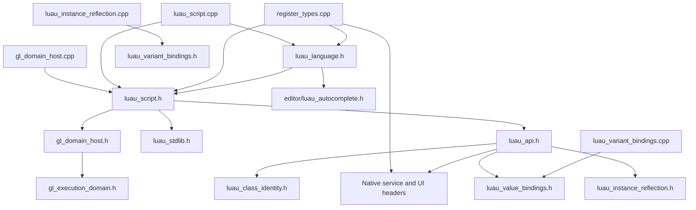

# GL-013 remaining-boundary assessment

Assessment date: 2026-10-28. Source revision:
[`08b2bb83b7093a361c80b147b4827eb22715ad32`](https://github.com/gmoddev/GodotLuau/tree/08b2bb83b7093a361c80b147b4827eb22715ad32),
after normal ClassName/IsA merge `35c993ce3711076a61dace5324f74691f4fb77ef`.
This focused assessment supplements [current architecture](current-architecture.md)
and the [qualification record](shared-domains-validation.md#fourth-extraction-main-integration-2026-10-28).
It does not replace the [invariants](invariants.md), accept a new ownership model,
or implement a fifth extraction. Recommendations below are proposals.

**Conclusion:** the four completed boundaries provide real implementation ownership
and incremental compilation isolation. They have not removed the main dependency
bottleneck. Prefer a script-environment implementation boundary in the existing
`luau_script.cpp`, including the narrow Instance-wrapper access needed by the
domain host, before another small helper extraction. Keep GL-013 open.

## Inventory and method

The [machine-readable inventory](evidence/gl013-boundary-assessment-2026-10-28.json)
records all 72 project native files: 64 headers, 2,048,878 LF-normalized bytes /
38,037 lines, and eight `.cpp` files, 80,141 bytes / 1,687 lines. It includes per-file
hashes, counts, include edges, direct/transitive consumers and affected translation
units. Vendored dependencies and test translation units are outside these totals.

Counts use tree-sitter 0.25.2 / tree-sitter-cpp 0.23.4 on unpreprocessed source.
Definitions are `function_definition` syntax nodes (including constructors and
methods); declarations are `declaration`/`field_declaration` nodes containing a
function declarator, including function-pointer forms. Lambdas are counted
separately. These are source inventory counts, not compiled symbol or overload
counts. Macros are not expanded; notably GUI macros define repeated methods.
Parser recovery around Godot macros, `operator` property names, Windows calling
conventions and `GDE_EXPORT` is recorded per file. GUI counts are approximate
syntax counts rather than an exact post-preprocessor function total. No parser
diagnostic is classified as a compiler defect. Embedded Luau is string data to
this parser, not C++ function definitions.

Includes are resolved relative to the file and then against the configured
project include directories; external Godot/Luau/STL headers remain named edges.
Visited-set traversal computes transitive consumers and include components.
There are **no project include cycles in this graph**. This does not establish
absence of runtime call cycles or external dependency cycles.

| Header (actual path under `src/`) | LF bytes | Lines | Definitions / declarations / lambdas | Direct / transitive project consumers | Adapter TUs affected |
| --- | ---: | ---: | ---: | ---: | ---: |
| `core/luau_api.h` | 274,780 | 4,838 | 41 / 0 / 195 | 1 / 8 | 3 |
| `core/luau_script.h` | 86,306 | 1,593 | 54 / 6 / 38 | 6 / 7 | 3 |
| `core/luau_stdlib.h` | 115,894 | 2,464 | 0 / 0 / 0 | 1 / 8 | 3 |
| `services/roblox_network.h` | 166,970 | 2,967 | 204 / 3 / 0 | 4 / 11 | 3 |
| `editor/luau_autocomplete.h` | 138,520 | 1,678 | 34 / 0 / 7 | 1 / 3 | 2 |
| `ui/roblox_gui.h` | 102,558 | 1,677 | 183 / 19 / 1 | 2 / 9 | 3 |

Other substantial files are not ignored: `roblox_lighting_fx.h` is 87,323 bytes /
1,446 lines (including 21,506 raw-string bytes); `roblox_services.h` is 83,257 /
1,620; `gl_settings_menu.h` 62,724 / 1,134; `gl_ui_modifiers.h` 61,143 / 1,094.
The last two and lighting reach registration only. The type database is 46,685 /
605, mostly completion metadata, with one C++ definition. Generated default-script
storage is 46,089 / 1,198, with zero definitions and 41,290 raw-string bytes.
Neither large metadata arrays nor embedded scripts justify mechanical splitting.
Do not regenerate these assets for GL-013.

| Existing `src/core/*.cpp` | LF bytes / lines | Definitions / declarations / lambdas | Transitive project headers |
| --- | ---: | ---: | ---: |
| `gl_execution_domain.cpp` | 31,973 / 663 | 49 / 0 / 9 | 1 |
| `gl_domain_host.cpp` | 14,437 / 252 | 15 / 0 / 20 | 42 |
| `luau_script.cpp` | 172 / 8 | 1 / 0 / 0 | 45 |
| `register_types.cpp` | 16,052 / 359 | 3 / 1 / 0 | 63 |
| `luau_value_bindings.cpp` | 10,405 / 260 | 24 / 0 / 3 | 1 |
| `luau_variant_bindings.cpp` | 1,601 / 36 | 2 / 0 / 0 | 2 |
| `luau_instance_reflection.cpp` | 1,878 / 53 | 3 / 0 / 0 | 2 |
| `luau_class_identity.cpp` | 3,623 / 56 | 2 / 0 / 0 | 1 |

SCons `SConstruct:28-57` adds project include directories and globs
`src/core/*.cpp`; `tests/runtime/CMakeLists.txt:39-52` independently discovers the
same adapter sources. A new `.cpp` placed only in `src/editor/` or `src/ui/` would
not be discovered by these globs. The Godot-free core target explicitly compiles
`gl_execution_domain.cpp`; it does not exercise native registration or UI.

## Responsibility and ownership map

Source references below refer to the recorded revision, not historical review
line numbers. Tests identify exercised behavior, not complete API qualification.

| Current owner and source anchors | Responsibility, consumers and dependencies | Lifetime / API exposure | Existing evidence and coupling |
| --- | --- | --- | --- |
| `luau_api.h:660-3919`, `3926-4656` | Instance userdata `__index` and property `__newindex`; class-specific methods, service bindings, value construction, fallback reflection, child lookup, lowercase retry and errors. Included directly only by `luau_script.h`. Depends on native character, GUI, service, network and gameplay classes. | Lua C functions re-resolve ObjectID; closures use owner references/handles. Dispatch order is externally visible. Class overrides precede generic adapters. Writes may reenter Lua/native dispatch. | `Integration.gd` exercises value/reflection/identity, hierarchy/errors and retained callbacks; network fixtures cover selected RPC/property flows. 3,260-line index and 731-line write implementation remain cohesive ordering bottlenecks; 195 lambdas complicate splitting by apparent method name. |
| `luau_api.h:89-236`, `244-653` | Wrapper push, CFrame/BrickColor/Vector2 bridges, inert signals/connections, hierarchy methods, attributes and GetService. Callers include script bootstrap and domain-host resumes through `luau_script.h`. | `wrap_node` adds the GodotObject metatable; `GLPushNodeHandle` in `gl_runtime.h:119` only allocates a handle and is not a drop-in replacement. `GLAttrWatch` stores ObjectID, state and non-recycled reference. `gl_attr_watchers()` is TU-local mutable storage. | Lifecycle/retained methods and callbacks have focused native coverage; not every signal/service does. Real connection and attribute operations cannot be treated as stateless alias helpers. GL-021 records an inert lowercase-alias discrepancy separately. |
| `luau_api.h:4667-4768` | Server replication hooks, subtree creation/reparenting and client apply; bootstrap installs `gl_apply_prop_hook`. Depends on NetworkService, network codec, role/service identity and dispatch write semantics. | Shared hook is external-inline state in `gl_runtime.h`; apply resolves a live state and can reenter `godot_object_newindex_impl`. No new authority boundary exists merely because a helper is extracted. | Existing network/functional animation fixtures cover stated paths, with GL-020 security qualification still separate. Keep apply/broadcast ordering together until an explicit interface preserves recursion and role behavior. |
| `luau_script.h:109-225`, `229-443`, `449-830` | Disk/default-template selection, template hashes, JSON collection conversion, synchronous HTTP, LuauScript source revision, ScriptNodeBase editor resource handling and executable lifecycle. Six direct consumers include language, domain host, registration, importer and DataModel. | Template cache owns `std::string` storage behind returned pointers; it is TU-local and avoids Godot objects at DLL teardown. Resource updates invalidate module identity and retire runs. JSON conversion and HTTP helpers have different contracts from generic Variant conversion. | Core tests cover module/source identity and owner rules; native fixtures cover source/reload/lifecycle. They do not qualify all editor duplicate/restore/template or HTTP behavior. Keep cache identity and editor I/O out of a bootstrap move. |
| `luau_script.h:832-1486`, `1492-1554` | Per-domain GodotObject metatable, value globals, game/workspace discovery, native globals, JSON/HTTP/network bridges, stdlib compile/load, RemoteFunction setup and child callback relay. Actual implementation is inline; `.cpp` currently owns only `_get_language()`. | Host claims initialization once per applicable Server/Client domain. Existing registration order and hidden bootstrap spawner are observable. Closures and pending work remain domain/owner controlled. | Native lifecycle, teardown, core module tests, value/reflection/identity and RPC fixtures are relevant. Static access proves API functions are referenced by InitializeDomain and `_gl_child_event`; remote setup also depends on transitively included network codec. This is the preferred next boundary. |
| `luau_stdlib.h:16-2462` | One embedded Luau bootstrap program: class/types, signals, task-backed services, tween/debris/tags, DataStore and compatibility facades. Sole direct consumer is script bootstrap. | One TU-local source pointer; execution is per domain, after native globals, with `_GLDomainSpawn` removed afterwards. Raw string occupies 114,637 bytes. | Core tests use their own domain bootstrap; actual production stdlib is exercised by native fixtures. Storage is intentional data packaging. Changing data storage must preserve exact bytes and load point, not redesign services or persistence. |
| `roblox_network.h:282-2964`, `gl_net_bridge.h:53-324` | NetworkService owns transport/session, roster/puppets, RPC/invoke bookkeeping, replication, animation state, view controls, coordinator/session files and startup. Codec owns tagged wire values, Node resolution and response maps. Direct network-header consumers: API, registration, workspace and workspace2d. | Mutable instance/session state and peer checks; codec response map/call ID are external-inline shared state, encode error storage is TU-local. Callbacks retain owner refs; service destruction/disconnect cleans pending invokes. | Native network and functional animation fixtures establish bounded behavior, not complete authority/codec validation. Direct host calls CancelInvoke and reads responses; removing the API include will not remove legitimate host/network coupling. A whole network extraction is too broad for the next step. |
| `editor/luau_autocomplete.h:106-1677`, `luau_type_database.h`, `luau_language.h:68,76,194` | Completion/type heuristics, fuzzy ranking, scene-expression resolution, multilingual API descriptions, usage persistence and selectable model JSON. Three entry points: suggestions, lookup, usage recording. | Godot editor/scene/resource APIs, no runtime execution-domain dependency. Function-local static icon, usage/model dictionaries and load flags have shared inline-method lifetime. These hints are not an authoritative runtime schema. | Native CI uses simulated editor-startup actors, not an actual editor-session completion/lookup fixture; ranking, model selection and cache teardown remain unasserted. Language and registration make two TUs parse this implementation; a dedicated implementation owner is credible once editor regression coverage exists. |
| `ui/roblox_gui.h:70-310`, `314-1675`, `gl_gui_core.h`, `gl_ui_modifiers.h` | GUI metadata/style adaptation, deferred relayout, macro-generated control methods, concrete Godot controls and Lua callbacks. Direct consumers are API and registration; importer also calls extra-property adaptation. | Control/object lifetime, deferred signal connections and callback refs; helper families include stateless adaptation and stateful controls. Existing layout/modifier owners already exist and should not be extracted again. | Current native fixtures create limited GUI identity objects, not exhaustive styling/layout/input behavior. A bounded metadata/style adapter is plausible; separating callback ownership or all controls now needs substantially more proof. |
| `gl_execution_domain.{h,cpp}`, `gl_domain_host.{h,cpp}`, `register_types.cpp:65-359` | Core owns VM/module/scheduler/reference lifetime without Godot; host resolves native resources, time, environment and service waits; registration binds Godot classes/language/loader/saver/editor plugin at ordered levels. | Process-level core reference index, per-domain owners, host ObjectID and Godot-managed instances. Scene teardown shuts domains before clearing material caches and loader/saver refs; server teardown unregisters language. | 39 core cases and selected native teardown/scene/session cases. Registration necessarily needs concrete class declarations; that does not require every method body to remain inline. Preserve initialization and shutdown ordering. |

## Dependency direction and compilation isolation

This compact graph shows actual project includes; arrows mean includes, not
runtime ownership. `HostCPP`, `ScriptCPP` and `RegisterCPP` are the three large
consumers. Their complete edges are in the inventory.

The four interfaces have a coherent lower-level direction: native value bindings
depend on Luau and STL, Variant conversion on public Godot values plus the value
interface, reflection on public Godot Object/property data plus Variant conversion,
and class identity independently on public Godot Object/String. None includes the
domain, dispatch, service, network or script implementations. Interface headers
forward-declare external types. No Godot dependency was introduced into the core
execution-domain implementation. Reflection is synchronous but not guaranteed
non-reentrant: its preserved Offset lookup can invoke Lua metamethods.

The reverse pressure comes from header implementation: script bootstrap includes
dispatch; dispatch includes concrete native classes; registration and native host
both include script definitions. The host additionally uses `wrap_node` directly
at `gl_domain_host.cpp:54,196,213`, NetworkService CancelInvoke at `109,148`, and
codec responses/decode at `111,212,221-235`. Those are real source dependencies,
not just incidental includes. Moving only InitializeDomain cannot make them vanish.
Registration also directly includes network, GUI and importer implementations.

Stored Linux Debug compiler dependency records from the qualified snapshot were
read with `ninja -t deps` using the eight explicit object targets. All eight
project include closures exactly match the static graph (including the `.cpp`
itself gives 43/46/64 inputs for host/script/registration). These are existing
GCC 13.3.0 records, not a fresh compile of the documentation revision. The only
source difference is the class `.cpp` EOF cleanup, with unchanged include edges.
The restored build manifest points to an older source root; querying its default
four targets would describe that older baseline instead. Snapshot records and
method are retained in the inventory. The container was returned to stopped.

Fan-out is not identical to cost. `gl_execution_domain.h` reaches four adapter TUs,
but its small core interface is an intentional shared contract. `luau_value_bindings.h`
reaches five, including its implementation, Variant, and the three dispatch
consumers. The large API/script/network/GUI implementations reach three; completion
and its database reach two. UI modifiers, lighting and importer implementation
reach registration only. Broad `gl_runtime.h` reaches 15 direct / many transitive
consumers, but still only three adapter TUs; moving its tiny accessors wholesale
would trade inlining for calls without resolving those owners.

Shared state must be classified before any future move: external-inline accessors
in `gl_runtime.h` intentionally unify network identity, roles, input/menu state,
orphan tracking and hook pointers; static-inline accessors can instead have
TU-local storage. Attribute watcher vectors, template cache and codec encode-error
storage are examples of the latter. Consolidating them can change behavior or
destruction order even when function text is unchanged. The core reference index
is already privately owned by `gl_execution_domain.cpp`. No new global registry,
engine-neutral framework, VM consolidation or schema is justified by this graph.

## Cumulative effect of the four extractions

Reliable historical source is locally available at the actual first-extraction
baseline `eb638bfa6ff16abc91d11742625b3cc034f53178`. `git show` and `git ls-tree`
confirm 290,353 LF bytes / 5,168 lines in API and four native core `.cpp` files.
The original review's differently versioned size is not used as this baseline.

| Boundary now independently owned | API after extraction: bytes / lines | Narrow interface | New ownership/coupling |
| --- | ---: | --- | --- |
| Vector3/Color3 values | 281,472 / 4,946 | Five value methods, five bridge functions, two registration calls | VM owns userdata; private callbacks move out of dispatch. Registration remains at original per-domain points. |
| Generic Variant conversion | 280,183 / 4,923 | Two conversion functions | Reuses value interface; no Node, domain or collection policy. |
| Instance property reflection | 278,169 / 4,885 | Membership, push, write | Reuses Variant interface; dispatch retains order, errors, hierarchy and ObjectID resolution. |
| Generic ClassName/IsA | 274,780 / 4,838 | Two functions | Public Godot-only identity implementation; owned String replaces borrowed fallback storage. No supported-call UAF was established historically. |

The API header decreased by 15,573 bytes (5.36%) and 330 lines (6.39%). Four new
implementation units total 17,507 bytes / 405 lines at this revision; interface
headers add 3,628 bytes / 79 lines. Wrappers/comments/declarations mean total source
size is not simply deleted. There are now eight adapter TUs. The final class unit
is one EOF newline shorter than its original measured source; historical records
are preserved rather than silently recomputed.

Source ownership checks find one definition of each moved function and no retained
duplicate implementation of these four responsibilities. Native value callbacks
are private to their unit; callers keep existing layouts and function names.
There are still distinct JSON collection and tagged network conversion paths;
these have different bounds, types and failure contracts and are not duplicate
implementations of the generic scalar/value adapter. Similar hierarchy fast paths
in bootstrap and generic dispatch are remaining compatibility coupling, not a
reason to consolidate them without tests.

Maintenance improves qualitatively: each narrow owner can change without editing
dispatch, and source dependencies can be inspected independently. Cost includes
four extra compilation/link inputs and interface contracts to maintain. Variant
and reflection deliberately depend on lower adapters; class identity does not
depend back on them. No domain ownership or registration subsystem was added.
The pattern remains worthwhile for meaningful boundaries, with diminishing value
from another isolated tiny helper while bootstrap still exposes everything.

The four [qualification manifests](shared-domains-validation.md) each measured
implementation-touch builds compiling **one TU**, versus API-header touch compiling
**three**, on Windows/Linux Debug/Release. Across those separate trials the own-unit
builds took 0.565–1.361 seconds including linking. These are not additive savings.
For the fourth extraction, baseline → candidate wall seconds were:

| Configuration | Extension-cold, dependencies warm | API header touch | Class implementation touch |
| --- | ---: | ---: | ---: |
| Windows Debug | 21.708 → 28.911 | 19.843 → 23.189 | 0.926 |
| Windows Release | 30.483 → 30.441 | 27.929 → 28.067 | 1.301 |
| Linux Debug | 22.899 → 22.951 | 21.948 → 21.797 | 1.266 |
| Linux Release | 42.123 → 42.025 | 40.720 → 40.421 | 0.615 |

There is no demonstrated general build speedup. Single trials used warm pinned
vendor objects, bounded parallelism and uncontrolled ambient load. Extension-cold
counts include two core-test compilation inputs; adapter count grew seven → eight.
Full dependency-clean cost, isolated header parsing CPU, isolated link cost and
peak memory were not measured. Object/library sizes in each manifest vary (fourth
Debug objects increase on both platforms; Release Linux library is unchanged).
There is no general binary-size reduction claim. Native functional tests do not
measure runtime performance; GL-019's separate benchmarks do not supply missing
GL-013 timings.

## Ranked future work — proposals, not authorization

### 1. Script-environment implementation and Instance access boundary (preferred)

**Problem/evidence:** `InitializeDomain` is 655 lines and contains the native
registration/stdlib bridge; remote setup and child relay add another 60 lines.
All are inline in a class header needed by native host, importer and registration.
The host's direct wrapper calls prevent a one-method move from isolating API.

**Proposed owner/interface:** move those three existing method bodies into the
existing `src/core/luau_script.cpp`; move private JSON/HTTP helpers used only by
bootstrap with them after confirming callers. Retain method declarations and
Godot-visible names. Expose one narrow internal wrapper-push declaration using
`lua_State*` and forward-declared `godot::Node*`, preserving nil/metatable/stack
behavior and one implementation. A small dedicated declaration header may be
needed by dispatch and host; do not include the script implementation back into
API or replace the metatable-bearing wrapper with raw `GLPushNodeHandle`.
Give host explicit runtime/errors/service/codec includes for its actual calls.

**Benefit/isolation:** target API and stdlib inclusion only in script implementation,
reducing API-change fan-out three → one if all source references and paths are
removed. This is a proposed acceptance fact, not a measured result. Network/service
and GUI headers still reach registration; host legitimately retains network/wait
dependencies, so network edits would still affect host plus script plus registration
unless separately narrowed. Script implementation edits already compile one TU;
the gain is removing dependencies from other consumers, not inventing that fact.
No additional TU is needed. Expect several hundred moved lines plus dependent
private helpers, one small interface and explicit-include corrections; avoid moving
the template cache, editor resource lifecycle or scheduler ownership incidentally.

**Risk/dependencies:** medium-high. Preserve initialization claim, hook installation,
metatable-before-globals order, game/workspace discovery, RemoteFunction bootstrap,
per-domain globals and bootstrap removal. Do not unify TU-local mutable stores by
accident or reorder Godot static destruction. Requires mapping helper callers and
state identity before movement, but no new VM/network architecture decision.

**Qualification gate:** exact pre/post callback registrations and stack contracts;
39 core cases and native lifecycle/scene reload/disable/destroy/module/GC/error,
value/reflection/identity, network and functional animation fixtures in supported
Windows/Linux Debug/Release configurations. Add focused per-domain first/second
initialization and retained child/module callback assertions where current fixtures
do not establish them. Verify ObjectID resolution after destroy/replacement and
shutdown cancellation, no cross-domain sharing, one wrapper definition, both build
globs, explicit includes, and compiler deps proving the promised API fan-out. Reuse
existing evidence only for unchanged inputs; no unconditional sanitizer guarantee.

### 2. Completion and lookup implementation owner

**Problem/evidence:** `luau_language.h` exposes the 138 KB autocomplete implementation
and 46 KB type database to script/registration TUs. Its actual calls are suggestions,
symbol lookup and usage recording (`luau_language.h:68,76,194`). The last call is
in the saver path and must not be missed.

**Owner/interface:** keep those three existing public static entry contracts and
result formats; move implementation, local parser/ranking helpers, API tables and
model/cache accessors behind declarations. A new `src/core/luau_autocomplete.cpp`
would be discovered by both current globs; changing discovery to support editor
sources is an alternative requiring its own explicit build review. Keep original
metadata/assets; no new authoritative type schema or regenerated model.

`RunQualification.py:41-43,76-102` starts every actor with `--headless --script`;
the Editor label selects `--glindex/--glcount/--gldevice`, not `--editor`. These
actors qualify supported startup arguments, not actual editor integration/UI.

**Benefit/scope/isolation:** medium implementation effort, roughly the cohesive
1,678-line header rather than a heuristic rewrite; completion/database edits target
one implementation TU instead of two runtime/registration consumers. One extra TU
is justified by independent editor responsibility and model state. No execution
domain dependency is needed. It can follow #1 or proceed independently.

**Risk/qualification:** medium. Preserve single shared inline-method cache identity,
Godot icon/resource lifetime, multilingual descriptions, save-time usage recording,
model reload when selection changes and malformed/missing-file fallback. Current
native CI is insufficient. First add focused headless Godot language completion,
lookup and saver/model fixtures covering empty/partial input, property/string
contexts, scene receivers, ranking, multilingual results, save/reload and teardown.
Then require core/native smoke checks and compiler deps showing metadata is parsed
only by its owner. Do not introduce cache teardown changes without a separate
lifetime finding and coverage.

### 3. GUI metadata and style adaptation

**Problem/evidence:** `gl_apply_rbx_gui_extra` (`roblox_gui.h:140-233`) adapts imported
and runtime properties; `gl_apply_rbx_gui_meta` (`240-307`) reapplies metadata from
control notifications. Importer calls the first at `rbx_importer.h:486`. The narrow
family includes rich-tag stripping (`121-134`), Godot controls/styles and property
precedence, not Lua callback delivery or the already separate layout core.

**Owner/interface:** explicit apply-extra-property returning handled/not-handled,
apply-metadata and text-normalization functions using Node/String/Variant, with
existing entry names preserved where required. Own them in one new core-discovered
`.cpp`, privately including concrete Godot style/control headers; keep current
control classes, layout signals and importer fallback ordering.

**Benefit/scope/isolation:** a few hundred lines, medium complexity, no VM ownership;
style algorithm edits compile one TU instead of three current consumers, while
GUI class-header changes still rebuild those consumers plus the new implementation.
A TU is defensible for the shared importer/control algorithm, not for a three-line
setter. Independent of #1/#2, but lower priority because much of the GUI header and
class dependency remains and visual regressions lack focused coverage.

**Risk/qualification:** medium-high compatibility risk, low direct native-lifetime
impact only if no control/Ref is retained across calls. Require imported-meta versus
runtime-setter parity, font/color/alignment/transparency/texture fallbacks, rich tags,
repeated reapply, parent resize/deferred notification, destroyed/replaced controls
and unload. Add headless property assertions plus targeted visual evidence for
rendered styling; existing identity smoke cases are insufficient. Reuse existing
layout owner and avoid new callbacks in this boundary.

### 4. Inert signals and lowercase signal aliases, as a follow-on

**Problem/evidence:** alias-copy (`luau_api.h:63-71`) and inert table construction
(`172-190`) depend only on public Luau. They are cohesive and stateless, unlike
real connections (`195-236`) which capture ObjectID/reference lifetime. There is
also a separately recorded construction-order discrepancy, GL-021.

**Owner/interface:** two stack-based Lua helper functions, privately owned callbacks,
no Godot or domain exposure, no retained state. Prefer the future binding owner
from #1 rather than a new TU just for about 30 lines. Never put signal policy in
the existing value/Variant/identity modules merely to reuse a file.

**Benefit/scope/isolation:** low effort and low lifetime risk, but little dependency
reduction; dispatch still needs all native headers. A dedicated CPP gives one-TU
helper edits only by adding another link input and does not reduce API fan-out.
Lower rank is deliberate. Resolve whether to preserve or separately correct GL-021
before movement; do not hide a behavior change in extraction.

**Qualification:** stack balance, exact Connect/Once/Wait and lowercase presence,
disconnect idempotence, Connected=false, nil Wait result, no references/callback
delivery under repeats, GC and fresh-domain teardown. Uppercase/lowercase behavior
needs direct regression assertions; the existing broad native matrix alone does
not establish this helper's complete contract.

## Boundaries to defer or keep together

- **Whole Instance method/property dispatch:** lookup interleaves methods, property
  reads, signals, class overrides and fallbacks. Property write is coupled to
  replication shadow/broadcast ordering; Offset conversion can reenter Lua. A
  handled/not-handled adapter must preserve stack/error behavior and priority.
  Splitting into a new class registry, generic visitor or many parameter objects
  is not justified. First establish class-specific method/property/alias/error
  fixtures and map reentrant edges, then select one cohesive native group.
- **Native service groups:** GetService (`562-653`) creates/locates containers and
  starts defaults; dispatch embeds Players, RunService, input, remote, animation
  and UI behavior. Each has different callback/authority contracts. One service
  may later be worthwhile, but no sufficiently isolated common interface is
  established here. Avoid a wholesale NetworkService split while session/invoke
  cleanup, shared response maps and authority remain intertwined. This assessment
  does not expand GL-003/004/005/007/009/020 or change wire formats.
- **Real callback/closure helpers:** `_gl_push_connection`, attributes, waits and
  GUI callback arrays carry different reference/owner cleanup protocols. Do not
  merge them with inert signals or move TU-local watchers into a process singleton
  casually. Require owner destruction during callbacks, nested resume, cancellation,
  reconnect/replacement and DLL shutdown coverage before defining their boundary.
- **Lowercase class/property aliases:** generic read fallback at `luau_api.h:3903-3911`
  retries with an uppercased initial after reflection and child lookup; class aliases
  already belong to the completed identity module. A string-only normalizer is
  tiny and does not own dispatch policy or remove Godot dependencies. Keep retry,
  stack replacement, precedence and final error with dispatch for now. Do not
  advertise a corresponding generic write fallback that the source does not have.
- **Embedded stdlib/templates:** #1 should place stdlib consumption in its real
  bootstrap implementation. A separate storage TU then offers less value; measure
  parsing/link duplication before adding one. Preserve exact Luau bytes, per-domain
  execution and disk-template cache/pointer behavior. Do not rewrite persistence
  or regenerate assets as part of storage movement.
- **Registration and tiny runtime accessors:** registration legitimately sees concrete
  Godot classes. Narrow implementation headers before partitioning registration;
  never reorder registration/shutdown to optimize source size. Small inline POD,
  accessors, generic templates and compile-time data can remain in headers when
  their contract is intentionally shared. Header-only code is not itself a defect.

## Assessment verification and limits

Executed static work: clean-tree source inventory, raw-string-aware syntax counts,
include graph/reverse consumers/SCCs, exact comparison of all eight compiler
dependency closures, source caller/state/registration review, historical Git
baseline checks, four-manifest measurement review, and documentation/diff/link
checks. Temporary parsers/scripts/output stay ignored under `.runtime-tests`;
only the evidence inventory is retained. No new native/local regression matrix,
editor/game launch, production/build/workflow/test change or fifth extraction.

The compiler records validate one qualified Linux Debug configuration, not every
platform/preprocessor branch. Source counts retain macro/parser limitations.
No fresh parse-time/link-only/memory/runtime benchmark was run; future fan-out
reductions are acceptance targets. Editor and GUI qualification gaps affect future
implementation readiness, not the completeness of this static prioritization.
GL-021 is a source-verified compatibility discrepancy, not a reproduced failure.
Existing correctness/security/lifetime gaps retain their separate issue status.

The assessment branch is `research/gl-013-remaining-boundaries`, based on the
verified main above, and must remain unmerged. Integration CI outcomes are in the
existing qualification record and ClassName evidence manifest, separate from this
documentation-only assessment. Stop here; the preferred extraction requires a
separately authorized implementation task.
